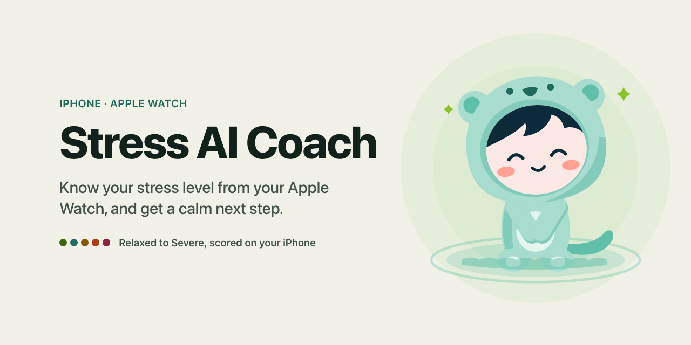
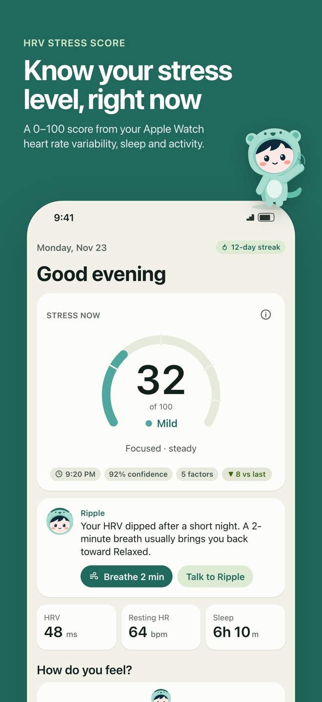
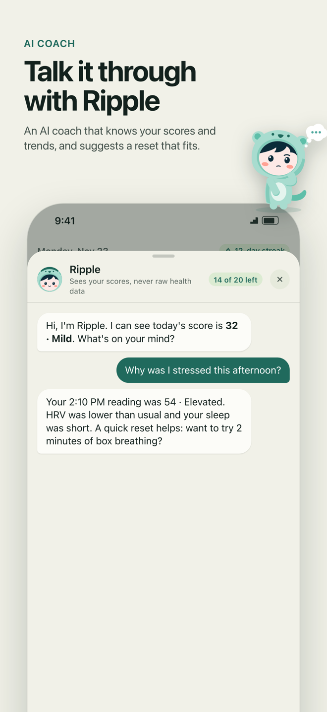
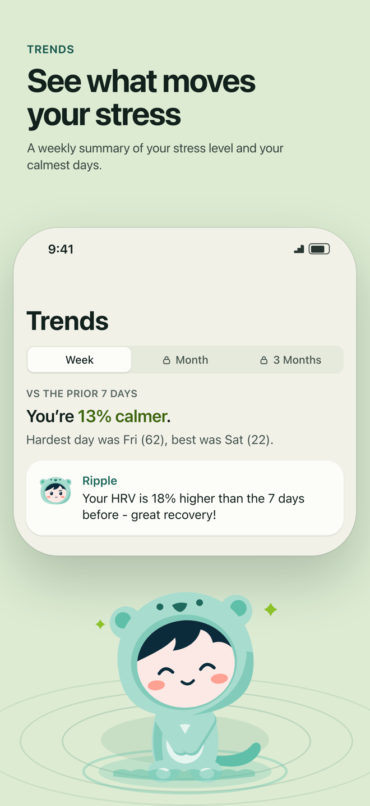
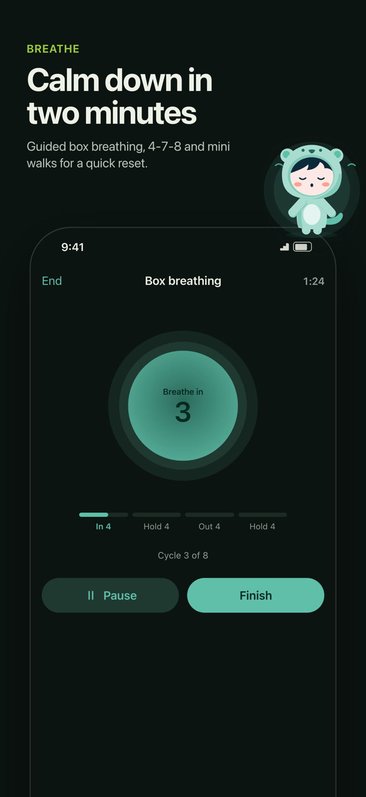
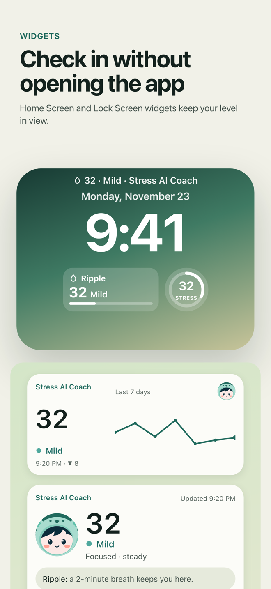
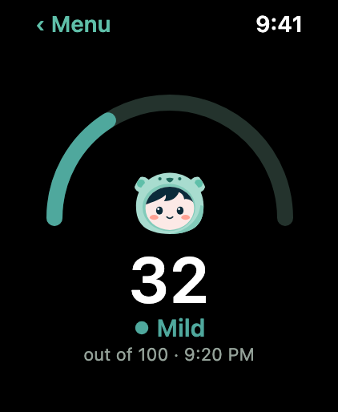
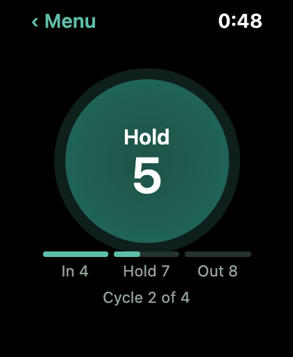
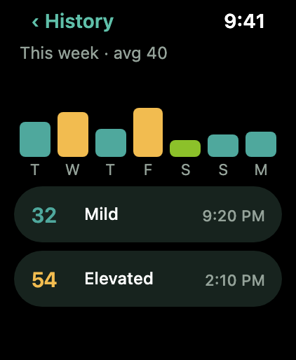
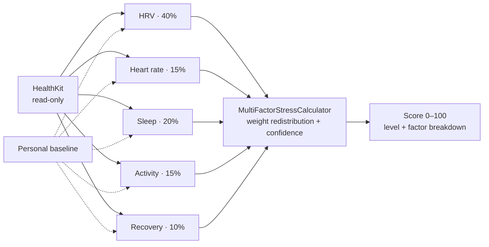

<p align="center">
  <picture>
    <source media="(prefers-color-scheme: dark)" srcset="docs/readme/hero-dark.png">
    
  </picture>
</p>

<p align="center">An iPhone and Apple Watch app that turns your heart-rate variability, sleep and activity into a personal stress score, then suggests a calm next step.</p>

<p align="center">
  <a href="https://apps.apple.com/app/id6778478266"></a>
</p>

<p align="center">
  <a href="https://developer.apple.com/ios/"></a>
  <a href="https://developer.apple.com/watchos/"></a>
  <a href="https://www.swift.org/"></a>
  <a href="https://apps.apple.com/app/id6778478266"></a>
</p>

> **Privacy by default.** HealthKit access is read-only and health data stays on your devices, with optional iCloud sync.
> The AI coach receives only the derived stress context with each message, never raw HealthKit samples.

**Status:** version 1.0.1 is live on the App Store; 1.1.0 is being prepared for submission. Stress AI Coach is a wellness app, not a medical device.

## Screenshots

<p align="center">
  
  
  
  
  
</p>

<p align="center">
  
  
  
</p>

## Features

| Understand | Act | Stay connected |
|---|---|---|
| **Five-factor stress score** from HRV, heart rate, sleep, activity and recovery | **Guided breathing** with animated pacing and before/after feedback | **Standalone Apple Watch app** with direct HealthKit access |
| **Personal baselines** adapt the model to your own physiology | **Mini Walk** offers a quick, timed reset | **Widgets and complications** show the latest state at a glance |
| **Confidence and factor breakdowns** explain every result | **AI coach Ripple** streams guidance through an authenticated API | **Optional iCloud sync** keeps devices aligned, offline-first |
| **History and trends** reveal patterns over time | **Mood and habit check-ins** add context to readings | **CSV and JSON export** keeps your data yours |

Also included: biological-age insights, notifications, light and dark appearance, and full deletion of local and iCloud data.

### Free and Plus

| | Free | Plus |
|---|---|---|
| Stress score, Apple Watch app, widgets, breathing, Mini Walk | ✓ | ✓ |
| AI chat with Ripple | 20 messages a month | Unlimited |
| Trends | The last week | Week, 30 days and 90 days |
| Charts | Weekly summary | All charts: daily bars, time in each level, monthly heatmap, HRV trend |

Plus costs **$4.99 a month** or **$25.99 a year** (US prices; App Store prices vary by region).

## How the stress score works

Each available signal is compared with your personal baseline. Missing signals have their weight shared among the rest, and the result is a 0–100 score with a confidence value and a per-factor breakdown.



| Score | Level | Meaning |
|---:|---|---|
| 0–24 | Relaxed | Low physiological strain |
| 25–49 | Mild | Some stress signals are raised |
| 50–74 | Elevated | A short reset may help |
| 75–89 | High | Several signals show meaningful strain |
| 90–100 | Severe | Strong physiological stress signals |

<p align="center">
   &nbsp;
   &nbsp;
   &nbsp;
   &nbsp;
  <br>
  <sub>Relaxed · Mild · Elevated · High · Severe</sub>
</p>

Every level is shown with colour, an icon and text, so colour is never the only cue.

## Architecture

MVVM with `@Observable` state, protocol-based dependency injection, Swift concurrency and an offline-first data layer.

```text
┌────────────────────────────────────────────────────────────┐
│ SwiftUI                                                    │
│ Views · AppRouter · WidgetKit · watchOS                    │
└───────────────────────────┬────────────────────────────────┘
                            │ user intent / observable state
┌───────────────────────────▼────────────────────────────────┐
│ View models                                                │
│ Stress · Dashboard · Trends · Chat · Settings · Premium   │
└───────────────────────────┬────────────────────────────────┘
                            │ protocol-based dependencies
┌───────────────────────────▼────────────────────────────────┐
│ Domain services                                            │
│ Algorithm · HealthKit · AI/API · StoreKit · Sync · Export │
└───────────────┬──────────────────────────────┬─────────────┘
                │                              │
┌───────────────▼──────────────┐  ┌────────────▼─────────────┐
│ Local and Apple data         │  │ External boundaries      │
│ SwiftData · HealthKit        │  │ CloudKit · Stress API    │
│ App Groups · Keychain        │  │ Firebase Authentication  │
└──────────────────────────────┘  └──────────────────────────┘
```

<details>
<summary><b>Core design decisions</b></summary>

- **Local-first persistence:** SwiftData is the primary store; CloudKit adds optional sync.
- **Explainable calculation:** five small `StressFactor` implementations feed one orchestrator instead of hiding logic in the UI.
- **Protocol boundaries:** HealthKit, persistence, CloudKit, StoreKit and network services are replaceable at the view-model boundary.
- **Unidirectional flow:** views send intent to view models; view models coordinate services and publish state back to SwiftUI.
- **Independent watch:** the watch target carries its own copy of the stress algorithm; App Groups and WatchConnectivity share presentation data.
- **Authenticated AI:** chat uses Firebase authentication and an SSE-streaming backend; only messages and derived stress context cross that boundary.

See the [system architecture](docs/system-architecture.md) for more.
</details>

## Development

**Requirements:** Xcode 26.3 or later (CI builds and tests with 26.3); Xcode 27.1 or later to compile the iPhone Duo layouts, as the App Store archive does. The app targets iOS 18.6 and the watch app watchOS 11.6.

```sh
open StressMonitor/StressMonitor.xcodeproj
```

Select the **StressMonitor** scheme and press ⌘R. Without HealthKit history (for example on a simulator), add the `-demo-mode` launch argument under Edit Scheme → Run → Arguments; the app then runs on simulated HealthKit data end to end.

**Firebase.** `GoogleService-Info.plist` is gitignored. AI chat and sign-in need it; stress scoring and demo mode do not. Ask a maintainer for a copy.

**Lint.** SwiftLint runs on every pull request with the rules in `.swiftlint.yml`.

**Tests.** Press ⌘U on the **StressMonitor** scheme. The `StressMonitorTests` suite runs on every pull request in GitHub Actions. See [Testing](docs/TESTING.md).

## CI/CD

| Pipeline | Trigger | What it does |
|---|---|---|
| Xcode Cloud **Beta** and **Release** | Started by `cd-testflight` / tags `release*` | Archive and upload to TestFlight (internal / external testers), on Xcode "Latest Release". The old Xcode Cloud PR Gate is off; GitHub Actions gates pull requests. |
| [`ci`](.github/workflows/ci.yml) | Pull request | SwiftLint, iOS, watchOS and widget builds, the test suite, and Release builds with Xcode 26.3 and 27.1 |
| [`cd-testflight`](.github/workflows/cd-testflight.yml) | Green `Build` on `main` | Starts Xcode Cloud Beta through the App Store Connect API and waits for the TestFlight build |
| [`testflight`](.github/workflows/testflight.yml) | Manual | Emergency TestFlight build from GitHub Actions when Xcode Cloud cannot ship |
| [`release`](.github/workflows/release.yml) | Manual | fastlane `release`: uploads listing text and screenshots for the latest TestFlight build; review is submitted by hand |
| [`screenshots`](.github/workflows/screenshots.yml) | Manual | Captures demo-mode screenshots in a simulator with AXe and opens a pull request |
| [`agent-verify`](.github/workflows/agent-verify.yml) | Push to `agent/**` | Cloud build, tests and screenshots for coding agents |
| [`xcodecloud-image-guard`](.github/workflows/xcodecloud-image-guard.yml) | Weekly | Checks every Xcode Cloud workflow's Xcode and macOS pairing is still valid |

Every Xcode Cloud build writes `GoogleService-Info.plist` from a secret right after checkout and **fails closed** if the secret is missing. Details: [deployment guide](docs/deployment-guide.md).

## Repository map

<details>
<summary>Folders</summary>

```text
StressMonitor/
├── StressMonitor/                 # iOS app target
│   ├── Models/  ViewModels/  Views/  Theme/
│   └── Services/                  # Algorithm, HealthKit, API/LLM, Repository/Sync, StoreKit
├── StressMonitorWatch Watch App/  # Standalone watchOS target
├── StressMonitorWidget/           # Home Screen and Lock Screen widgets
├── StressMonitorTests/            # Test target
└── ci_scripts/                    # Xcode Cloud scripts
design/                            # Design system, screen prototypes, Ripple art
metadata/                          # App Store listing text, screenshots, previews
docs/                              # Product and engineering docs
scripts/  fastlane/  .github/      # Tooling and CI
```

The Xcode project is `StressMonitor/StressMonitor.xcodeproj`. Similarly named folders at the repository root are legacy and not part of the build.
</details>

## Documentation

- [Getting started](docs/GETTING-STARTED.md)
- [Documentation index](docs/INDEX.md)
- [Product overview (PDR)](docs/project-overview-pdr.md)
- [System architecture](docs/system-architecture.md)
- [Testing](docs/TESTING.md)
- [Configuration and signing](docs/CONFIGURATION.md)
- [Code standards](docs/code-standards.md)
- [Design guidelines](docs/design-guidelines.md)
- [Deployment guide](docs/deployment-guide.md)

---

Built by Phuong Doan.
